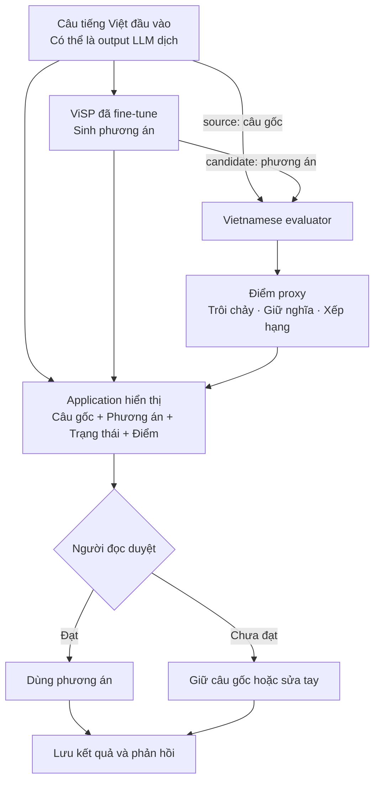

# ViSP + Vietnamese Evaluator — Hướng dẫn bàn giao NLP501

**Bộ dữ liệu gồm 1.050 câu đã được nhóm review**

> Cả hai model đã train và kiểm tra nạp lại thật. ViSP chưa vượt baseline giữ nguyên theo chrF++; evaluator chưa nên làm metric chính. Application hiện nên cho người đọc duyệt phương án; xác nhận độc lập bởi người đọc vẫn đang chờ.

## Bắt đầu ở đây

**Sample output chung một file:** [Xem câu gốc → output có đánh dấu thay đổi → điểm evaluator và JSON đầy đủ](examples/SAMPLE_OUTPUT.md).

1. Tải **[gói đủ cả hai model ở Release v1.0.0](https://github.com/Deyuhnat/NLB/releases/tag/v1.0.0)**, chọn `BAN_GIAO_VISP_VA_EVALUATOR_20261118.zip` (1,27 GB).
2. Giải nén vào thư mục mới, cài Python theo phần “Chạy trên máy nhận” bên dưới.
3. Chạy ba bước: sinh câu → ghép câu gốc/phương án → chấm điểm. Không cần training lại để inference.
4. Đọc output và giới hạn; nếu làm application, dùng phần hợp đồng tích hợp/API phía dưới.

**Lưu ý:** `git clone`, `Code → Download ZIP` và hai file `Source code` GitHub tự tạo **không chứa weights**. ZIP bàn giao trong Release mới có full weights. Nếu đã clone repo, chép đầy đủ hai thư mục `visp_finetune/runs/lr_1e-05/best/` và `vi_evaluator/checkpoint/` từ ZIP bàn giao vào đúng vị trí, hoặc chạy thử trực tiếp trong thư mục giải nén riêng.

Không chỉ chép một file `.safetensors`: cần config, tokenizer, head/gate cùng phiên bản. README trên nhánh main được cập nhật sau snapshot ZIP; ZIP giữ nguyên để bảo toàn checksum.

## Workflow application



Evaluator nhận **cả câu gốc và phương án**, không sinh câu và không xác minh độ trung thành với nguyên tác tiếng Trung. Hai checkpoint và API evaluator đã có; giao diện application/API generator chung là phần nhóm cần tích hợp tiếp.

## Kiểm tra ZIP tải về

```powershell
Get-FileHash .\BAN_GIAO_VISP_VA_EVALUATOR_20261118.zip -Algorithm SHA256
```

SHA-256 mong đợi:

```text
31d3e74705efa14fbfcafedf4c82466ed09560401319a20476e971ecb08edb8c
```

## Hai model đã train

| Thành phần | Việc thực hiện | Kết quả và giới hạn |
|---|---|---|
| ViSP generator | Full fine-tune model ViSP có sẵn bằng 697 cặp train nhóm; 141 dev chọn checkpoint, 150 test hồi cứu. Checkpoint LR=1e-5, epoch 1. | chrF++ 89,79; ViSP gốc 76,59; giữ nguyên câu 92,56. Chưa vượt baseline giữ nguyên. |
| Vietnamese evaluator | Full encoder foundation trên 365.311 cặp ViSP train hợp lệ sau loại rò rỉ/trùng; adaptation bằng 697 nguồn nhóm; chọn bằng 141 dev. Có đối chứng bỏ foundation. | Đã train, reload và chạy API. Semantic MAE 0,1847, kém baseline hằng 0,0444; Spearman -0,4735. Chưa khuyến nghị làm metric chính. |

Không dùng toàn bộ 1.177.942 dòng ViSP để train evaluator: số đó gồm cả validation/test. Các split giữ riêng để đánh giá. 1.050 câu nhóm cũng không dùng hết làm train; có dev/test và các mẫu loại trừ, xem manifest của từng thí nghiệm.

## Luồng sử dụng

Câu tiếng Việt → ViSP sinh phương án → evaluator chấm cặp câu gốc/phương án → application hiển thị để đọc và kiểm tra.

Hai checkpoint khác nhau, không ghi đè hoặc thay thế nhau. Gate được chọn trên dev của evaluator hiện giữ câu gốc trên toàn bộ dev và 240 câu test mới. Không bật tự động áp dụng sửa câu chỉ dựa vào điểm proxy hiện tại. Gói có teacher.py để chấm tham chiếu tự động; teacher cần tải model Hugging Face ở lần đầu và cũng chưa được người đọc hiệu chuẩn. Không có kết quả benchmark độc lập đã xác nhận bởi người đọc.

JFLEG/SEEDA là cơ sở thiết kế đánh giá; đây không phải hai model chính thức được retrain. Bộ này không xác nhận độ trung thành với nguyên tác tiếng Trung, không dùng ngữ cảnh và không gồm hướng emotion.

## Trong ZIP có gì?

- visp_finetune/: full weights/tokenizer tại runs/lr_1e-05/best/, infer.py, source training, notebook đã chạy, dữ liệu chia sẵn, báo cáo và bằng chứng kiểm tra.
- vi_evaluator/: checkpoint/, inference.py, api.py, teacher.py, báo cáo, source/notebook training và bằng chứng reload/API.
- prepare_evaluator_input.py: ghép input gốc và output ViSP theo sample_id để chấm, giữ trạng thái sinh câu.
- FILE_MANIFEST.json: SHA-256 từng file. SHA-256 ZIP nằm ở RELEASE.json bên ngoài ZIP.

Full weights đã đủ cho inference hoặc bắt đầu một lượt fine-tune mới. Optimizer/RNG checkpoint latest.pt của generator không nằm trong gói; cần output Kaggle nếu muốn resume chính xác lượt cũ. Notebook/source evaluator có cấu hình và dữ liệu nhóm, script tải corpus công khai ở revision đã khóa; không kèm lại toàn bộ corpus công khai hoặc model teacher. Môi trường .venv không được đóng gói.

## Chạy trên máy nhận

Mở PowerShell tại thư mục giải nén, cài Python 3.11. Lệnh tạo môi trường CPU:

```powershell
py -3.11 -m venv .venv
& .venv\Scripts\python.exe -m pip install torch==2.6.0 --index-url https://download.pytorch.org/whl/cpu
& .venv\Scripts\python.exe -m pip install -r visp_finetune\requirements.txt -r vi_evaluator\requirements.txt
```

Sinh câu, ghép input rồi chấm (chọn tên output mới khi chạy lại):

```powershell
& .venv\Scripts\python.exe -X utf8 visp_finetune\infer.py --model visp_finetune\runs\lr_1e-05\best --input visp_finetune\data\inference_example.jsonl --output predictions.jsonl --device cpu
& .venv\Scripts\python.exe -X utf8 prepare_evaluator_input.py --input visp_finetune\data\inference_example.jsonl --predictions predictions.jsonl --output pairs.jsonl
& .venv\Scripts\python.exe -X utf8 vi_evaluator\inference.py --checkpoint vi_evaluator\checkpoint --input pairs.jsonl --output scored.jsonl --device cpu
```

scored.jsonl giữ source, candidate, trạng thái sinh và điểm evaluation. rank_score là điểm xếp hạng thô; fluency_delta_proxy và semantic_preservation_proxy là ước lượng tự động, không phải điểm người chấm 0–100. grammar_score=null, human_validated=false, context_used=false. Câu vượt giới hạn token của evaluator phải được chia nhỏ, không bị cắt âm thầm.

API evaluator tùy chọn:

```powershell
& .venv\Scripts\python.exe -m pip install fastapi uvicorn
$env:VI_EVALUATOR_CHECKPOINT = (Resolve-Path vi_evaluator\checkpoint).Path
& .venv\Scripts\python.exe -m uvicorn api:app --app-dir vi_evaluator --host 127.0.0.1 --port 8000
```

POST /score nhận JSON có source và candidate. Đã kiểm tra model thật qua HTTP: input hợp lệ 200, rỗng/quá dài 422. Đây là API chấm câu; ViSP chạy qua infer.py, không tuyên bố đã có API generator chung.

## Đọc báo cáo

- visp_finetune/reports/KET_QUA_FULL_FINETUNE.html
- visp_finetune/evaluation_model/KET_QUA_DANH_GIA.html (đánh giá tự động, tách khỏi phiếu người đọc)
- vi_evaluator/reports/BAO_CAO_BAN_GIAO.html
- vi_evaluator/reports/MODEL_READINESS.json

## Notebook đã chạy (Private)

- ViSP: https://www.kaggle.com/code/nettopro/visp-full-fine-tune-nlp501?scriptVersionId=370624086
- Evaluator: https://www.kaggle.com/code/nettopro/vietnamese-evaluator-visp-team-full-training?scriptVersionId=371052411

ZIP đủ để chạy inference local, không cần quyền Kaggle hoặc database. Muốn mở notebook Private cần quyền tài khoản phù hợp.


## Hợp đồng tích hợp cho bạn làm application

| Thành phần | Input | Output/cách dùng |
|---|---|---|
| Generator ViSP | `sample_id`, `input_vi` | `output_vi` là candidate; giữ `raw_output`, `status`, `fallback`, `error`, `latency_ms` để kiểm tra lỗi. |
| Công cụ ghép cặp | Input gốc và predictions có cùng tập ID | Ghép bằng `sample_id`, không bằng vị trí dòng; từ chối ID trùng hoặc thiếu. |
| Evaluator | `source`, `candidate`: hai chuỗi tiếng Việt không rỗng | Trả điểm proxy, không phải quyết định sửa câu đã được xác nhận. |

Input JSONL riêng có thể gồm:

```json
{"sample_id":"new_001","input_vi":"Hắn đối với chuyện này cảm thấy khó hiểu."}
{"sample_id":"new_002","input_vi":"Nàng nhìn ra ngoài cửa sổ."}
```

Thay `--input` ở **cả bước sinh câu và bước ghép cặp** bằng file này; giữ ID duy nhất. Đây là ví dụ định dạng, không phải benchmark. Chọn tên output mới khi chạy lại để tránh `FileExistsError`.

| Trường điểm | Ý nghĩa |
|---|---|
| `rank_score` | Điểm thô để so các phương án **cùng source**, chưa hiệu chuẩn thành xác suất. |
| `fluency_delta_proxy` | Ước lượng NLL(source) − NLL(candidate) của teacher; dương dự đoán candidate trôi chảy hơn theo proxy. |
| `semantic_preservation_proxy` | Ước lượng cosine teacher; head hiện chưa đủ chất lượng làm metric chính. |
| `grammar_score` | `null`: chưa có nhãn/head ngữ pháp riêng. |
| `human_validated`, `context_used` | Đều `false`: chưa hiệu chuẩn bởi người đọc và không xem ngữ cảnh. |

Không chuyển điểm thành “độ chính xác 95%” hoặc điểm người chấm 0–100. Không tính fallback giữ nguyên câu như một cải thiện thành công. Application nên hiển thị source, candidate, trạng thái và điểm, rồi cho người đọc chọn/sửa.

Sau khi khởi động API theo lệnh phía trên, mở `http://127.0.0.1:8000/docs` hoặc gọi từ cửa sổ PowerShell khác:

```powershell
$payload = @{ source = 'Hắn đối với chuyện này cảm thấy khó hiểu.'; candidate = 'Hắn cảm thấy chuyện này khó hiểu.' } | ConvertTo-Json
Invoke-RestMethod -Method Post -Uri 'http://127.0.0.1:8000/score' -ContentType 'application/json; charset=utf-8' -Body ([System.Text.Encoding]::UTF8.GetBytes($payload))
```

HTTP 200: thành công; 422: input rỗng/sai định dạng/quá dài; 503: chưa đặt biến checkpoint. Evaluator giới hạn **512 token mỗi câu** và không cắt âm thầm. Backend cần chia câu quá dài và giữ liên kết với đoạn gốc. CPU local đã kiểm tra với Torch 2.6.0 + Transformers 4.57.3; GPU cần bản Torch phù hợp CUDA của máy thay bản CPU.

## Nếu muốn tái lập training hoặc phát triển tiếp

Giữ nguyên checkpoint bàn giao, dùng thư mục output mới. Không cần thực hiện phần này khi chỉ chạy inference.

**Generator:** trên môi trường GPU đủ dependencies, mở terminal tại `visp_finetune/`:

```text
python -m unittest -v test_finetune
python full_finetune.py train --data data --output runs_new_experiment
python full_finetune.py evaluate --data data --output runs_new_experiment
```

Các lệnh trên tái lập cấu hình training trong source, **không mặc nhiên học tiếp từ checkpoint đã fine-tune**. Nếu muốn học tiếp, phải chỉnh rõ đường nạp model và lưu cấu hình thí nghiệm mới. Lệnh train chặn CPU. Có thể dùng `ViSP_Full_Finetune_Kaggle.ipynb`; bản `.executed.ipynb` là log lượt cũ.

**Evaluator:** giải nén `vi_evaluator/training_source/Vietnamese_Evaluator_Training_Source.zip` vào thư mục nghiên cứu mới. Đọc README/config và mở `delivery/Vietnamese_Evaluator_Kaggle.ipynb` trong source ZIP. Notebook tự chứa gồm các bước tải corpus revision đã khóa, foundation, adaptation, đối chứng và đánh giá; cần GPU và Internet. Không chạy train ngay trong thư mục inference rồi ghi đè checkpoint bàn giao.

Full weights cho phép inference hoặc bắt đầu fine-tune mới; **resume chính xác** lượt cũ cần optimizer/scheduler/RNG checkpoint. Gói không gồm `latest.pt` của generator, cần output Kaggle nếu muốn resume đúng trạng thái đó.

Chọn checkpoint bằng dev; không tune theo test đã xem rồi báo lại như test mù. Cải thiện evaluator cần nhãn chất lượng và kiểm tra với baseline; thêm paraphrase đơn thuần chưa bảo đảm chấm độ tự nhiên tốt hơn. Thí nghiệm mới không tự thừa hưởng kết quả kiểm chứng của model cũ.

## Bằng chứng và giới hạn cần biết

- [Bằng chứng ViSP](visp_finetune/verification/final_verification.json): full training đã kiểm chứng; reload CPU cho 3/3 output thử khớp Kaggle.
- [Reload evaluator](vi_evaluator/verification/real_model_reload.json): nạp checkpoint thật, điểm CPU/GPU khớp trong sai số 1e-4.
- [API smoke](vi_evaluator/verification/api_smoke.json): HTTP thực tế 200/422 đã kiểm tra.
- [Readiness evaluator](vi_evaluator/reports/MODEL_READINESS.json): semantic MAE 0,1847 so với baseline hằng 0,0444; Spearman −0,4735 trên 584 cặp output duy nhất của test mới. Chưa khuyến nghị làm metric chính.
- Gate giữ câu gốc trên toàn bộ dev và 240 câu test mới. Không coi retrieval gần 100% là độ tự nhiên 100%.
- Thể loại test mới thực tế là **Tiên hiệp / Kỳ ảo / Huyền huyễn**, chưa bao phủ đầy đủ mọi thể loại trong đề xuất ban đầu.
- Teacher tham chiếu trong `teacher.py` cũng là proxy; tải model Hugging Face lần đầu, embedding teacher giới hạn 128 token. Không thay thế người đọc độc lập.

## Lỗi thường gặp

| Lỗi | Cách xử lý |
|---|---|
| Không thấy weights sau clone | Tải đúng ZIP bàn giao trong Release; dùng cả thư mục checkpoint. |
| `FileExistsError` | Đổi tên output, giữ kết quả cũ để đối chiếu. |
| Không thấy file/module | Chạy quickstart từ thư mục gốc có cả hai project. |
| Thiếu Torch/Transformers | Dùng đúng `.venv\Scripts\python.exe` đã cài dependencies. |
| API 503 | Đặt `VI_EVALUATOR_CHECKPOINT` thành đường dẫn checkpoint, khởi động lại API. |
| API 422 | Kiểm tra hai chuỗi không rỗng, đúng kiểu và không quá token limit. |
| CUDA thiếu bộ nhớ | Chạy inference CPU trước hoặc giảm batch trong thí nghiệm mới. |
| Điểm khó diễn giải / gate không sửa | Giới hạn model hiện tại; không tự coi điểm proxy là xác suất chất lượng. |

Repo public để chuyển giao. Inference local không cần key/database; cài dependencies và tải teacher lần đầu vẫn cần Internet.
