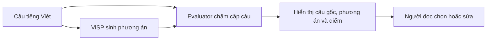

# ViSP + Vietnamese Evaluator — NLP501

**Bộ dữ liệu gồm 1.050 câu đã được nhóm review**

## Tải cả hai model

Mở [Release v1.0.0](https://github.com/Deyuhnat/NLB/releases/tag/v1.0.0), tải `BAN_GIAO_VISP_VA_EVALUATOR_20261118.zip` rồi giải nén. Gói khoảng 1,27 GB có **full weights của cả ViSP và evaluator**, tokenizer, source, notebook và báo cáo. `Source code (zip)` do GitHub tạo chỉ chứa source, không chứa weights.

Repo này giữ source và cấu hình để clone nhanh. Weights lớn được phân phối qua Release.

| Thành phần | Vai trò | Tình trạng |
|---|---|---|
| ViSP | Sinh phương án diễn đạt lại tiếng Việt | Full fine-tune; CPU reload đã kiểm chứng. chrF++ 89,79 so với ViSP gốc 76,59, nhưng baseline giữ nguyên đạt 92,56. |
| Vietnamese evaluator | Chấm cặp câu gốc/phương án | Đã train, reload và kiểm tra HTTP API. Semantic head chưa vượt baseline; chưa khuyến nghị làm metric chính. |

## Luồng tích hợp

Xem [hướng dẫn chạy đầy đủ](DOC_TRUOC.md), [báo cáo ViSP](visp_finetune/reports/KET_QUA_FULL_FINETUNE.md) và [readiness evaluator](vi_evaluator/reports/MODEL_READINESS.json).

Evaluator có foundation trên 365.311 cặp ViSP train hợp lệ; adaptation bằng 697 nguồn train nhóm. Validation/test giữ riêng. Đây là evaluator tiếng Việt của nhóm, không phải hai model JFLEG/SEEDA chính thức được retrain.

Gate hiện giữ câu gốc trên toàn bộ dev và test mới. Điểm là proxy tự động, không phải điểm người đọc 0–100; chưa có xác nhận độc lập bởi người đọc. Teacher tham chiếu tự động có trong `vi_evaluator/teacher.py`. Không xác nhận độ trung thành với nguyên tác tiếng Trung.

Gói không gồm optimizer checkpoint `latest.pt`; full weights cho phép inference và bắt đầu fine-tune mới. Xem notebook Kaggle đã khóa để truy xuất lượt chạy cũ.
